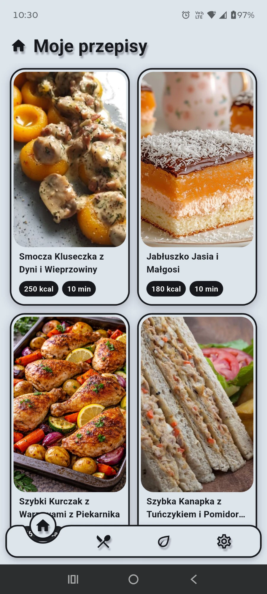
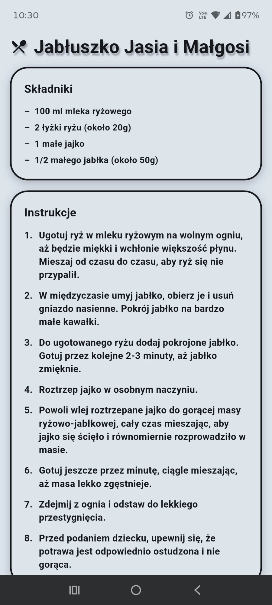

# Everyday Chef

Everyday Chef is a Flutter app that turns the products you have at home into a ready-to-cook recipe. Type, dictate or photograph your ingredients, set your preferences and get a recipe generated by Google Gemini, in seconds.

<p>
  
  
</p>

## Features

- **Recipe from your ingredients** – write them, dictate them by voice or scan a photo of your fridge or table.
- **Meal type** – breakfast, lunch, dinner, snack, dessert, or just a dish (then pick soup, salad, main course, pasta, sandwich, smoothie or bowl).
- **Recipe options** – calorie range, cooking time, regular or sport diet, optional "use only my ingredients".
- **Kids mode** – safe recipes for children aged 0–5 with age-appropriate texture, no frying or baking, and fairy-tale recipe names.
- **Dietary needs** – vegan, vegetarian, gluten free, lactose free, sugar free, low carb / keto, halal, kosher, plus allergies and disliked products.
- **Cooking skill level and gender** to tune complexity and nutrition.
- **Nutrition info** – calories, protein, carbohydrates and fat for every recipe.
- **My recipes** – save favorites and continue your last recipe.
- **Cooking timers** while you follow the steps.
- **Languages** – English, Polish and Russian; recipes are generated in the app language.

## Tech

Flutter, Provider, easy_localization, Google Generative AI (Gemini), speech_to_text, image_picker.

## Running

Create a `keys.env` file in the project root:

```
GOOGLE_AI_STUDIO_KEY=your_key
```

Then:

```bash
flutter pub get
flutter run
```
